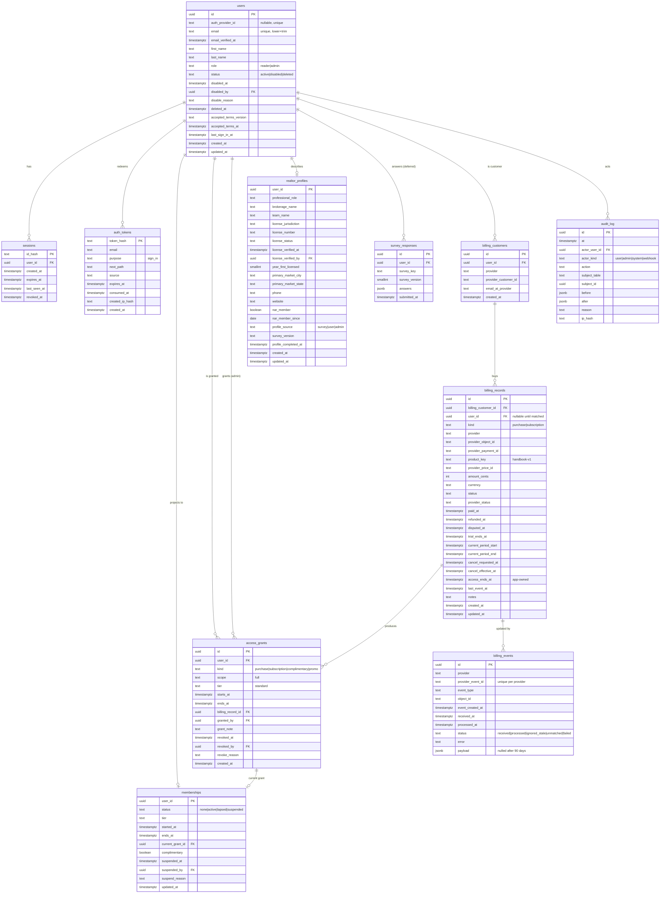

# User database, sign-in and lead capture: implementation-ready plan

Written 8 November 2026. Planning only: nothing in this document has been built, no dependency added, no migration applied, no service provisioned. The only repository change is this file. The brief that produced it is reproduced in Appendix A.

Three planning passes ran in parallel (data model and lifecycle; authentication, authorization and privacy; billing and survey compatibility) and were consolidated here. Where they disagreed, the choice and the reason are stated inline.

Revised the same day after an external review. Added: a recovery and consistency subsection for the multi-statement webhook path (10.4), a recovery path for a failed "your handbook is ready" email, the exact conditional statement for sliding session renewal, a rate limit on the verify endpoint, the upsell card as a designed Phase 2 deliverable, email DNS and the D9 media answer as Phase 0 launch blockers, and a cross-reference from D1 to the content-revision plan.

## 0. Summary

- **One `users` table** for everyone: preview readers, members and administrators are the same identity with different facts attached. Role is a column on the user. Membership is derived from `access_grants`. Billing is mirrored from the payment provider into `billing_*` tables. Entitlement is a pure function of those facts, computed at read time, never stored as an editable field.
- **Sign-in is a passwordless magic link** built on the stack already here: Neon Postgres, the lead pipeline's handler, store and mail pattern, and Node's crypto. No new dependency. Neon Auth (managed Better Auth) was evaluated and is the documented alternative.
- **The home page becomes the sign-up surface.** The email form moves into the hero as the primary action, is repeated after the live calculator and at the end of the page, and the same form is sign-in for returning readers.
- **Billing models a one-time, edition-scoped purchase first**, because every sentence the site has drafted implies one, with columns that let a subscription row fit later without a migration.
- **The survey is deferred.** A `realtor_profiles` table with every column optional exists so the survey has somewhere to write; accounts, preview and billing never read it.
- **Launch blocker 1** in `docs/_archive/launch-handoff.md` (no paid access gate) is resolved by this plan; blockers 2 to 5 (checkout, pricing, policies) remain owner inputs and are listed under open decisions. Two operational items are launch blockers regardless of any decision: a verified transactional sender (SPF and DKIM, section 3.3) and the owner's answer on whether the public media files are member-only (D9, section 9).

## 1. Findings from the existing codebase

| Area | What exists | File | Implication |
|---|---|---|---|
| Framework | Next.js 16.4.2 App Router, React 19.3, TypeScript strict, zod 4, Tailwind 4; `pnpm` scripts `typecheck`, `test` (vitest), `e2e` (playwright) | `package.json`, `AGENTS.md` | `proxy.ts` is the request gate in this version (`middleware.ts` is a deprecation stub); read `node_modules/next/dist/docs/.../proxy.md` before writing it |
| Database | Neon Postgres 17 over `@neondatabase/serverless` HTTP driver; one stateless statement per call, no interactive transactions (fixed batches via the driver's `transaction()` only) | `lib/leads/neon-store.ts`, `.env.example` | Every write path that touches two tables must be a single statement (CTE), idempotent and reorderable, or a fixed `transaction([...])` batch |
| Schema | Two tables: `leads` (lower-cased unique email, stored consent text, `source`) and `lead_attempts` (salted IP hash); text columns with `check (... in (...))`, `gen_random_uuid()` keys, commented statements the code relies on | `db/migrations/001_leads.sql` | New migrations mirror these conventions; `leads` is a marketing list, not an account ("it is not an account" is in the stored consent text, `lib/leads/config.ts`) |
| Lead pipeline | Origin allow-list, honeypot `_gotcha`, salted-hash rate limit, zod at the boundary, identical replies for new and repeat addresses, SendGrid or Mailpit via plain `fetch`, Memory/File/Neon stores selected by `storeFromEnv`, handler tests with fakes | `lib/leads/handler.ts`, `store.ts`, `mail.ts`, `validate.ts`, `app/api/lead/route.ts` | The pattern every auth, access and billing module copies |
| Authentication | None. No users, sessions, passwords or provider | `app/(product)/account/page.tsx` says so | Build here or adopt Neon Auth (section 3) |
| Authorization | None. `/handbook/*` and the full-text `search-index.json` are public; the product layout is only `noindex` | `app/(product)/layout.tsx`, `app/search-index.json/route.ts` | Both must be gated; `public/downloads/*` and `public/audio/*` are served by the static layer and cannot be gated by proxy (owner decision in section 16) |
| Product routes | `app/(product)/handbook/[slug]/page.tsx` is statically generated (`generateStaticParams`, `dynamicParams = false`); chapter ids are the `PageId` union in `lib/pages.ts` | | Chapter-level entitlement needs the page to become dynamic (section 9) |
| Reader progress | `localStorage` only (`handbookState`, `handbookSettings`, `handbookCoach`); backup and restore on the account page | `lib/state/`, `components/handbook/AccountPanels.tsx` | Out of scope; nothing moves server-side. Cancellation and refund never touch progress |
| Offer | Hosted-checkout URL, one price, "Access to this edition, with its updates"; `purchaseOpen()` is the single switch; pricing page says "One handbook, one price", "no tiers and no add-ons" | `lib/offer.ts`, `app/(public)/pricing/page.tsx` | One-time purchase first; one `product_key` for edition 1.0 |
| Policies | Privacy, terms, refunds, updates are drafts with `<Decision>` markers; privacy says "It sets no cookies of its own" and describes local storage and the optional email form | `app/(public)/privacy/page.tsx` etc. | Privacy must gain a cookie disclosure and an accounts section before launch |
| Free sample | `/preview` is anonymous (Chapter 1 section, one script, the planner); `docs/plans/free-sample-decision.md` recommends Chapter 1 and Chapter 7 as the sample and retiring the "first four chapters" promise on `/signup` | `app/(public)/preview/page.tsx`, `app/(public)/signup/page.tsx` (uncommitted) | The free page set is a code constant (`FREE_PAGE_IDS`), not a database fact |
| Uncommitted work | `/signup` page, `SignupForm.tsx` (front-end only, sends nothing), header, footer and sitemap links, CSS, an e2e case, `docs/plans/free-sample-decision.md`, `downloads/` | `git status` | Preserved. The sitemap entry for a page that cannot deliver yet should be held back until the form sends |
| Organizations | No teams, brokerages or tenants anywhere in code; the audience is individual first-year agents | grep of `lib/`, `components/`, `app/` | Individual-only. No multi-tenant structures. Brokerage and team are profile text fields |
| Hosting | Vercel project linked; Neon project `morning-credit-15469990`; previews share the production `DATABASE_URL` today | `docs/_archive/nextjs-migration-plan.md`, `docs/_archive/vercel-preview-plan.md` | Webhook and auth testing on previews needs a Neon branch |

## 2. Home page lead generation

The hero today offers two buttons and neither converts: "See pricing and availability" leads to a page that says nothing is for sale, and "Try a sample lesson" collects nothing. Until purchase opens, the only conversion available is an email address, so the email form becomes the primary action. These are best-practice lead-generation principles applied to this page, not a redesign.

1. **The form goes in the hero**, replacing the button stack. One field, one button with a value-specific label ("Send me the free chapters", wording depends on open decision D1), one trust line: "No password, no card. The link we email also signs you in next time." The existing `components/site/SignupForm.tsx` keeps its honeypot, validation and inbox-check state and gains a `variant` prop (`hero`, `card`, `inline`) and a `source` prop.
2. **Other actions become text links** under the form: "Try the sample lesson without an email" and "Pricing and availability". When `purchaseOpen()` is true, the buy button returns as the primary action and the form moves to the right-hand column.
3. **Capture after the calculator win.** `components/site/HeroPlan.tsx` is the strongest hook on the page. Once a visitor edits a number, show one line under the results: "Keep this number. Enter your email and Chapter 1 opens with it saved." Same form, `source: 'calculator'`. Capturing after effort converts better than a cold form.
4. **Repeat the form** in the final section with `source: 'final'`. `/signup` stays as the standalone landing page for links and ads with `source: 'signup-page'`; `/signin` is the same form with sign-in copy and `source: 'signin'`.
5. **Returning readers** with a session cookie see "Welcome back. Open the handbook" in the hero instead of the form, and the header shows "Open the handbook" instead of "Sign in".
6. **Placement measurement without a tracker.** Store `source` on every link request and count requests against completed sign-ins in the database. That answers which placement earns its space; no analytics dependency is added.
7. **No invented proof.** The handoff doc records that no reviews exist. Specific claims do the work: chapter titles, named tools, "every tool works".
8. **Success state** stays inline: "Check your inbox at <address>", "Didn't get it? Send again" after 30 seconds, "Use a different email".

Marketing consent is separate from signing in. The sign-in form shows "By continuing you agree to the Terms and the Privacy policy" (a versioned sentence, section 12). A separate optional checkbox "Send me occasional notes about the handbook" posts through the existing `/api/lead` handler with `source: 'signup'`, and that list uses confirmed opt-in as `docs/plans/free-sample-decision.md` recommends. Signing in never implies marketing consent.

## 3. Sign-in: magic link on the existing stack

### 3.1 Build here or Neon Auth

Recommendation: **build here**. Zero new dependencies (the user-level `CLAUDE.md` asks before adding one, and the codebase chose plain `fetch` over the SendGrid SDK), full control of token hygiene and enumeration resistance, tests that run offline with the Memory and File stores like the lead tests do, and about 400 lines of owned code. The lead pipeline has already proved every piece the magic link needs.

| Concern | Build here | Neon Auth (Managed Better Auth, magic-link plugin) |
|---|---|---|
| Dependencies | none | `@neondatabase/auth`, a cookie secret, a catch-all `/api/auth/[...]` route, proxy integration |
| Email | existing `lib/leads/mail.ts`, Mailpit locally | Neon's shared SMTP in dev; production magic links need custom SMTP configured in Neon; e2e cannot read mail from Mailpit |
| Session revocation | delete the session row; immediate everywhere | revocable via admin plugin; short-lived JWTs not revocable once issued |
| Rate limiting, enumeration | ours, same salted-hash pattern as `lead_attempts` | provider-side, not tunable |
| Prefetch safety | GET shows a button, POST consumes | link consumes on GET; mail-scanner prefetch is a known hazard without a custom verify page |
| Admin, grants, billing, audit | ours in both cases | admin plugin gives user list and ban only |
| Lock-in | none | users and sessions in a `neon_auth` schema; every preview URL must be registered as a trusted domain |
| Future social login, passkeys | more work | Google and GitHub ready; passkeys and MFA not on Managed |

Assumption: no social login before launch. The `users.auth_provider_id` column keeps the door open; nothing in grants, memberships or billing would change if Neon Auth is adopted later.

### 3.2 Flow

1. **Request.** `POST /api/auth/request-link` with `{ email, termsVersion, source, next, _gotcha }`. Origin header required and allow-listed (stricter than `handleLead`, which tolerates a missing Origin). Rate limits: 5 per IP per 10 minutes, 3 per email hash per hour. Email normalized by the shared zod chain (trim, lower-case; no dot or plus rewriting). A single-use token is created: 32 random bytes, base64url in the link, only the SHA-256 hash stored, 15-minute expiry, with the normalized email and a validated `next` path (must start with `/`, not `//`, no scheme) stored server-side. The reply is `200 {ok:true}` and the email is identical whether or not the address is known. **No user row is created at request time**, so typos and bots never create users.
2. **Verify page.** `GET /auth/verify?token=` performs a read-only lookup and renders either the generic "link expired or already used" card with a prefilled resend form, or a one-button form "Sign me in" that JavaScript submits automatically. Mail scanners and link previewers that GET the URL consume nothing.
3. **Consume.** `POST /api/auth/verify` runs one atomic statement: `update auth_tokens set consumed_at = now() where token_hash = $1 and consumed_at is null and expires_at > now() returning email, next_path`. No row means one generic failure. The verify endpoint is rate-limited with the same `auth_attempts` pattern as request-link (10 per IP per 10 minutes), so the failure card cannot be used to probe token hashes by volume. On success it upserts the user (sets `email_verified_at` and `accepted_terms_version`), writes a session row, sets the cookie, updates `users.last_sign_in_at`, and redirects to `next` or `/handbook`. If `ADMIN_BOOTSTRAP_EMAILS` names this address and the users table has zero admins, the role is set to admin, an owner grant is inserted and both are audited (section 12).
4. **Session.** Cookie `__Host-hb_session` in production (`hb_session` over plain http locally), `HttpOnly; Secure; SameSite=Lax; Path=/`, Max-Age 90 days. The cookie carries a random 32-byte id; the table stores its hash. Sliding renewal: the data-access layer extends `expires_at` at most once per 24 hours with one conditional statement, so concurrent requests cannot race or double-extend: `update sessions set expires_at = now() + interval '90 days', last_seen_at = now() where id_hash = $1 and revoked_at is null and expires_at > now() and last_seen_at < now() - interval '24 hours'`. Zero rows updated is the normal case, not an error. Proxy re-emits the cookie with a fresh Max-Age on gated routes without touching the database. Absolute cap: sessions older than one year are refused. Lax is required so the emailed link's top-level navigation carries the cookie on the following POST.
5. **Sign-out.** `POST /api/auth/sign-out` deletes that session; "Sign out everywhere" on the account page deletes all of the user's sessions. Admin disable deletes all sessions too. Revocation takes effect on the next data-access-layer call, not at the proxy edge: proxy checks only the cookie's shape (section 9), so a revoked cookie passes proxy and is then rejected by `getViewer()` before any content renders. That is acceptable because proxy never serves content itself.
6. **Returning readers** use the same form. The response never reveals whether the address exists.

### 3.3 Email

A plain-text transactional message: subject "Your sign-in link", one link, "expires in 15 minutes", "if you did not ask for this, ignore it". The sender in `lib/leads/mail.ts` currently refuses to send without a postal address, which is right for the marketing note but not required for a transactional sign-in message; the auth mailer relaxes that one check. **Launch blocker.** A transactional from-address on a domain the owner controls, with SPF and DKIM verified at SendGrid and a test link landing in the inbox (not spam) of at least one Gmail and one Outlook account, is a Phase 0 item (section 13). Without it sign-in links land in spam and the whole flow fails silently. The marketing welcome text ("The book stays free to read") in `lib/leads/mail.ts` must be rewritten before any real send, and no real send happens before the DNS check passes.

## 4. The user model

The brief names three kinds of people. They are one table with five independent facts:

| Facet | Question | Where it lives | Who writes it |
|---|---|---|---|
| Identity | Who is this person | `users` (id, email, names, verification, account status) | the person, via sign-in |
| Role | What may they administer | `users.role` (`reader` or `admin`) | an admin, never the person, never billing |
| Membership | What is their relationship to the product | `access_grants` (the facts) and `memberships` (suspension plus a cached projection) | billing webhook or an admin; suspension only by an admin |
| Billing | What have they paid for | `billing_customers`, `billing_records`, `billing_events` | the payment provider, mirrored; never edited by hand |
| Entitlement | What can they read now | computed by `entitlement(user, grants, billing, now)` | nobody; it is derived |

The cases in the brief resolve without contradictory states:

- An administrator who is also a member: `role = 'admin'` plus an active grant.
- A member with complimentary access: a grant with `kind = 'complimentary'`, `granted_by` and a note, and no billing rows.
- A preview user with no billing account: a user row and nothing else.
- Billing never grants administration: the webhook code path has no write to `users.role`, and the admin handlers are the only writers of it, each audited.
- Admin role never grants content by itself: the entitlement function ignores role. This was the one point the planning passes disagreed on; the single-rule path wins because demoting an admin then never silently removes their reading, and the bootstrap step inserts an owner grant so the owner reads through the same rule as everyone else.

Columns on `users` versus separate tables: role stays a column (two values, no expiry; a `user_roles` table is the upgrade path if a third role appears). Membership is not a column on `users`, because "account active, membership active, no grant" would be a representable contradiction; it is derived from grants. The realtor profile is a separate 1:1 table because it is mostly null for months, keeps personal data in one deletable place, and keeps the table every request joins narrow. One license is a set of columns, not a child table: the audience is first-year agents with one jurisdiction; a `licenses` table is the upgrade path and only `lib/users/` would change.

## 5. Entity-relationship diagram



## 6. Field dictionary

Sources: U = the user, A = the auth system, P = the payment provider (mirrored, never edited), Ad = an administrator, S = the future survey, Sy = the system. All tables use `uuid` primary keys with `gen_random_uuid()`, `timestamptz`, and `text` with `check (... in (...))` instead of Postgres enum types, matching `001_leads.sql`.

### 6.1 `users`

| Column | Type | Required | Default | Constraints | Source | Purpose |
|---|---|---|---|---|---|---|
| id | uuid | yes | gen_random_uuid() | PK; the only key other tables reference | Sy | Stable internal id |
| auth_provider_id | text | no | null | partial unique where not null | A | Provider user id if Neon Auth is adopted; null for in-house auth |
| email | text | yes | | unique index; `check (email = lower(btrim(email)))`; zod max 254 | U | Sign-in address. Trim and lower-case only; never the relational key |
| email_verified_at | timestamptz | no | null | | A | Set on first successful link consume |
| first_name | text | no | null | zod max 100 | U or S | Salutation; collected later, never at sign-up |
| last_name | text | no | null | zod max 100 | U or S | |
| role | text | yes | 'reader' | `check (role in ('reader','admin'))` | Ad | Administrative privilege, independent of membership and billing |
| status | text | yes | 'active' | `check (status in ('active','disabled','deleted'))` | Ad or Sy | Account-level switch. Disabled stops sign-in and revokes sessions; deleted is anonymized |
| disabled_at, disabled_by, disable_reason | timestamptz, uuid FK users, text | no | null | all three null or all three set | Ad | Why and by whom, visible in the admin list |
| deleted_at | timestamptz | no | null | set iff status = 'deleted' | Sy | Anonymization time |
| accepted_terms_version, accepted_terms_at | text, timestamptz | no | null | version must exist in `lib/auth/config.ts` | A | The terms sentence shown when they first signed in |
| last_sign_in_at | timestamptz | no | null | | A | Written on link consume only |
| created_at, updated_at | timestamptz | yes | now() | app sets `updated_at` on every update | Sy | |

### 6.2 `auth_tokens` (in-house auth only)

| Column | Type | Required | Default | Constraints | Source | Purpose |
|---|---|---|---|---|---|---|
| token_hash | text | yes | | PK; SHA-256 hex of 32 random bytes | A | Raw token exists only in the emailed link |
| email | text | yes | | same normalization check as users | U | The address the link went to; no user may exist yet |
| purpose | text | yes | 'sign_in' | `check in ('sign_in')`; 'email_change' later | A | |
| next_path | text | no | null | validated: starts with `/`, not `//`, no scheme | Sy | Post-sign-in destination, stored server-side so the link is never an open redirect |
| source | text | no | null | `check in ('hero','calculator','final','signup-page','signin','account')` | Sy | Which placement produced the request (section 2) |
| expires_at | timestamptz | yes | | index | A | 15 minutes |
| consumed_at | timestamptz | no | null | | A | Single use, set atomically |
| created_ip_hash | text | no | null | salted like `lead_attempts.ip_hash` | Sy | Rate limiting |
| created_at | timestamptz | yes | now() | | Sy | |

### 6.3 `sessions` (in-house auth only)

| Column | Type | Required | Default | Constraints | Source | Purpose |
|---|---|---|---|---|---|---|
| id_hash | text | yes | | PK; SHA-256 of the cookie value | A | |
| user_id | uuid | yes | | FK users on delete cascade; index | A | |
| created_at | timestamptz | yes | now() | | Sy | Absolute cap: refused after one year |
| expires_at | timestamptz | yes | | index | A | 90 days, sliding |
| last_seen_at | timestamptz | yes | now() | written only by the single conditional update in section 3.2, at most once per 24 hours | A | Activity signal and the renewal guard |
| revoked_at | timestamptz | no | null | | A or Ad | Sign-out, sign out everywhere, admin disable |

No user agent and no IP are stored on sessions (data minimization). A device list on the account page, if wanted later, would add a user-agent column then.

### 6.4 `auth_attempts`

Same shape as `lead_attempts`: `scope text` (`'ip'` or `'email'`), `key_hash text`, `at timestamptz`, index on `(scope, key_hash, at desc)`, rows older than a day deleted on the request path in a separate statement.

### 6.5 `access_grants`

| Column | Type | Required | Default | Constraints | Source | Purpose |
|---|---|---|---|---|---|---|
| id | uuid | yes | gen_random_uuid() | PK | Sy | |
| user_id | uuid | yes | | FK users on delete restrict; partial index where revoked_at is null | Sy | |
| kind | text | yes | | `check in ('purchase','subscription','complimentary','promo')` | P or Ad | Why access exists |
| scope | text | yes | 'full' | `check (scope = 'full')` now; a `scope_pages text[]` of PageId later if partial grants are ever wanted | Sy | What it unlocks |
| tier | text | yes | 'standard' | `check in ('standard')` now | P or Ad | Plan or edition; one tier at launch |
| starts_at | timestamptz | yes | now() | | P or Ad | |
| ends_at | timestamptz | no | null | null = indefinite (edition lifetime) | P or Ad | Mirrors `billing_records.access_ends_at` for paid grants |
| billing_record_id | uuid | no | null | FK billing_records on delete set null; required iff kind in (purchase, subscription) | P | Traceability to money |
| granted_by | uuid | no | null | FK users; required iff kind in (complimentary, promo) | Ad | |
| grant_note | text | no | null | zod max 500 | Ad | The reason for a complimentary grant |
| revoked_at, revoked_by, revoke_reason | timestamptz, uuid, text | no | null | all-or-none; reason `in ('refund','chargeback','abuse','admin','expired_promo')` | P or Ad | |
| created_at | timestamptz | yes | now() | | Sy | |

### 6.6 `memberships` (suspension plus cached projection)

| Column | Type | Required | Default | Constraints | Source | Purpose |
|---|---|---|---|---|---|---|
| user_id | uuid | yes | | PK, FK users on delete cascade | Sy | |
| status | text | yes | 'none' | `check in ('none','active','lapsed','suspended')`; `check ((status = 'suspended') = (suspended_at is not null))` | Sy | Derived by `recomputeMembership`; read by admin lists, never by enforcement |
| tier, started_at, ends_at, current_grant_id, complimentary | text, timestamptz, timestamptz, uuid FK access_grants on delete set null, boolean | no | null / false | | Sy | Projection of the current grant |
| suspended_at, suspended_by, suspend_reason | timestamptz, uuid FK users, text | no | null | all-or-none | Ad | The only hand-written fields. Suspension stops paid content and nothing else |
| updated_at | timestamptz | yes | now() | | Sy | |

### 6.7 `billing_customers`

| Column | Type | Required | Constraints | Source | Purpose |
|---|---|---|---|---|---|
| id | uuid PK | yes | | Sy | |
| user_id | uuid | yes | FK users on delete restrict; `unique (user_id, provider)` | Sy | One customer per provider per user; a second provider customer id for the same user is a reconciliation flag, not a second row |
| provider | text | yes | `check in ('stripe','lemonsqueezy','paddle','manual')` (extend when chosen) | P | `'manual'` for owner-recorded offline sales |
| provider_customer_id | text | yes | `unique (provider, provider_customer_id)` | P | |
| email_at_provider | text | no | normalized | P | Only to diagnose mismatches |
| created_at, updated_at | timestamptz | yes | | Sy | |

### 6.8 `billing_records` (one row per purchase or subscription)

| Column | Type | Required | Default | Constraints | Owner | Purchase | Subscription |
|---|---|---|---|---|---|---|---|
| id | uuid | yes | gen_random_uuid() | PK | Sy | | |
| kind | text | yes | | `check in ('purchase','subscription')` | Sy | | |
| billing_customer_id | uuid | no | null | FK billing_customers on delete restrict | Sy | | |
| user_id | uuid | no | null | FK users on delete restrict; index `(user_id, product_key)` | Sy | null until matched | same |
| provider | text | yes | | | Sy | | |
| provider_object_id | text | yes | | `unique (provider, provider_object_id)` | P | checkout session or order id | subscription id |
| provider_payment_id | text | no | null | | P | payment id | latest invoice id |
| product_key | text | yes | | | Sy | `'handbook-v1'` | `'handbook'` |
| provider_price_id | text | no | null | | P | | |
| amount_cents, currency | int, text | no | null | | P | what was paid; for records, not display | |
| status | text | yes | | purchase: `pending, paid, refunded, partially_refunded, disputed, chargeback_lost`; subscription: `incomplete, trialing, active, past_due, unpaid, canceled, paused` | P | | |
| provider_status | text | no | null | | P | raw provider string for debugging | |
| paid_at, refunded_at, disputed_at | timestamptz | no | null | | P | | |
| trial_ends_at, current_period_start, current_period_end | timestamptz | no | null | | P | null | |
| cancel_requested_at | timestamptz | no | null | | P | null | when cancel-at-period-end was asked |
| cancel_effective_at | timestamptz | no | null | | P | null | period end or immediate cancel time |
| access_ends_at | timestamptz | no | null | | **app** | null = lifetime for the edition; set by refund or chargeback | `current_period_end + grace` while past due; `cancel_effective_at` when canceled |
| last_event_at | timestamptz | no | null | | P event time | ordering guard | |
| ready_email_sent_at | timestamptz | no | null | | **app** | when the "your handbook is ready" link was sent; null on a paid row means a send is due (section 10.4) | same |
| notes | text | no | null | zod max 1000 | Ad | | |
| created_at, updated_at | timestamptz | yes | now() | | Sy | | |

Provider-owned columns are mirrored and never edited in the app or an admin screen. If an administrator needs to change access they create or revoke an `access_grants` row, which is audited. **Never stored:** card number, expiry, security code, bank account, billing address, card brand or last four, provider API keys or webhook secrets (env only), tax ids. The provider's customer portal link covers everything else.

### 6.9 `billing_events` (webhook ledger)

`id uuid PK`, `provider text`, `provider_event_id text` with `unique (provider, provider_event_id)`, `event_type text`, `object_id text`, `event_created_at timestamptz` (the provider's time), `received_at`, `processed_at`, `status text check in ('received','processed','ignored_stale','unmatched','failed')`, `error text`, `payload jsonb`. Index `(object_id, event_created_at)`. The payload is nulled after 90 days by the reconciliation job; the row stays.

### 6.10 `realtor_profiles` (all optional; written by the survey or the account page)

| Column | Type | Constraints | Source | Initial or deferred |
|---|---|---|---|---|
| user_id | uuid PK, FK users on delete cascade | | Sy | initial |
| professional_role | text | `check in ('agent','broker','team_lead','assistant','student','other')` | U or S | initial |
| brokerage_name | text | zod max 200 | U or S | initial |
| team_name | text | zod max 200 | U or S | initial |
| license_jurisdiction | text | zod enum of US states and territories plus 'other' | U or S | initial |
| license_number | text | zod max 50, stored as entered | U or S | initial column; collect only when there is a use for it |
| license_status | text | `check in ('pending','active','inactive','expired','unknown')` | U or S | initial |
| license_verified_at, license_verified_by | timestamptz, uuid FK users | pair | Ad | initial column; the verification process itself is deferred |
| year_first_licensed | smallint | `check between 1950 and extract(year from now()) + 1` | U or S | initial |
| primary_market_city, primary_market_state | text | | U or S | initial |
| phone | text | E.164 in zod, max 20 | U or S | initial |
| website | text | https only, max 300 | U or S | deferred (low value for first-year agents) |
| nar_member, nar_member_since | boolean, date | nullable; never inferred from licensure, brokerage or title | U or S | initial |
| service_areas, specialties | text[] | | S | deferred to the survey |
| learning_goals | text | zod max 2000 | S | deferred to the survey |
| profile_source | text | `check in ('survey','user','admin')` | Sy | initial; record-level provenance |
| survey_version | text | | Sy | initial |
| profile_completed_at | timestamptz | | Sy | initial |
| created_at, updated_at | timestamptz | | Sy | initial |

Email is not duplicated here; it lives on `users`. Real estate licensure (`license_*`) and REALTOR® association membership (`nar_member*`) are separate facts and neither is derived from the other.

### 6.11 `survey_responses` (deferred)

`id uuid PK`, `user_id FK users on delete cascade`, `survey_key text` (for example `'onboarding'`), `survey_version smallint`, `answers jsonb` validated by a per-version zod schema, `submitted_at timestamptz`, `unique (user_id, survey_key, survey_version)`. Created only if the owner wants to analyze answers that do not map to a profile column (section 11).

### 6.12 `audit_log`

`id uuid PK`, `at timestamptz default now()`, `actor_user_id uuid null FK users on delete set null`, `actor_kind text check in ('user','admin','system','webhook')`, `action text` (`user.disable`, `user.enable`, `user.anonymize`, `role.set`, `grant.create`, `grant.revoke`, `membership.suspend`, `membership.unsuspend`, `session.revoke_all`, `billing.link_user`, `billing.event`, `billing.resend_ready_email`, `bootstrap_admin`), `subject_table text`, `subject_id uuid`, `before jsonb`, `after jsonb`, `reason text`, `ip_hash text`. Indexes on `(subject_table, subject_id)` and `(actor_user_id, at desc)`. Never contains tokens, payloads with card data, or raw addresses. Append-only; no update or delete path exists in the application.

## 7. Status definitions and transitions

### 7.1 Account status (`users.status`)

| From | To | Actor | Side effects |
|---|---|---|---|
| active | disabled | admin (never self) | delete all sessions; set the disabled triple; audit. Membership and billing untouched |
| disabled | active | admin | clear the triple; audit |
| active or disabled | deleted | the user (typed-email confirmation) or admin | anonymize (section 12.4); audit |
| deleted | any | none | terminal |

### 7.2 Membership status (derived) and suspension

```
recomputeMembership(userId, now):
  if memberships.suspended_at is not null                          -> 'suspended'
  else if exists grant g where g.revoked_at is null
          and g.starts_at <= now and (g.ends_at is null or g.ends_at > now)
                                                                   -> 'active'; current_grant_id = g
                                                                      (prefer purchase/subscription over complimentary, then latest ends_at)
  else if exists any grant for the user                            -> 'lapsed'
  else                                                             -> 'none'
```

Recompute runs after every grant insert or revoke, every `billing_records.access_ends_at` change, every suspension change, and lazily when a gate read finds `ends_at` in the past. Hand transitions are only `active -> suspended` (admin, reason required) and `suspended -> whatever recompute decides` (admin clears suspension). Nothing else writes `status`.

The preference order inside recompute (purchase or subscription before complimentary) only decides which grant the projection displays as `current_grant_id`. It has no bearing on access: entitlement (section 8) treats any non-revoked, in-window grant as sufficient whatever its kind, and reads `memberships` for one field only, `suspended_at`. A stale or drifted `memberships.status` can neither grant nor remove content.

**Suspension versus disabled, stated plainly.** Disabled is on `users` and stops sign-in entirely: sessions deleted, magic links fail generically, no emails. Suspended is on `memberships` and stops paid content only: the person can still sign in, see the account page and the free chapters, and manage billing. A disabled admin cannot administer; a suspended admin still can, because role is on `users`. Suspension never cancels anything at the provider; refunds are a human decision.

### 7.3 Billing status (mirrored) and its effect on grants

| From | To | Trigger | Grant effect |
|---|---|---|---|
| pending or incomplete | paid or active | checkout completed, payment succeeded | insert grant (kind purchase or subscription, `ends_at` = `access_ends_at`); send the "your handbook is ready" sign-in link |
| active | past_due | payment failed (subscription) | none until grace ends; `access_ends_at = current_period_end + 7 days` |
| past_due | active | payment recovered | `access_ends_at` null; grant `ends_at` null |
| past_due | unpaid | provider gave up retrying | `access_ends_at = max(now, access_ends_at)`; grant `ends_at` follows |
| active | canceled (at period end) | user asked; `cancel_requested_at`, `cancel_effective_at` set | grant `ends_at = cancel_effective_at`; access continues to the date |
| paid or active | refunded | full refund issued in the provider dashboard | revoke grant with reason refund; `access_ends_at = now` |
| paid | partially_refunded | partial refund | access unchanged (policy default) |
| paid | disputed | dispute opened | access unchanged until the dispute is lost (policy default) |
| disputed | chargeback_lost | dispute lost | revoke grant with reason chargeback; audit; an admin may suspend by hand, never automatically |
| canceled | new row active | reactivation | new provider subscription, new row; the old row stays for history |

Billing writes `access_grants` and `billing_*` only. It never writes `users.role`, `users.status` or `memberships.suspended_*`.

## 8. Access matrix and entitlement rules

| Capability | Anonymous | Preview user (signed in, no entitlement) | Member | Admin |
|---|---|---|---|---|
| Public pages (`/`, `/preview`, `/pricing`, `/about`, policies) | read | read | read | read |
| Free chapters inside `/handbook` (`FREE_PAGE_IDS`) | redirect to `/signup?next=` | read | read | read |
| Member chapters, `/handbook/start`, the search index | redirect | upsell card, no content | read | read only if entitled (an owner grant is inserted at bootstrap) |
| Own profile data (`/account`: email, sign-in time, sessions, profile fields) | none | read, edit profile, sign out everywhere, delete account | same | same |
| Own billing info | none | "no purchase" plus pricing link | provider status, dates, manage link | same for own |
| List users, view audit log | none | none | none | yes |
| Change a role | none | none | none | yes, never own |
| Grant or revoke access, suspend, disable | none | none | none | yes, never own, always audited |

Entitlement is a pure function in `lib/access/entitlement.ts` with inputs user, grants, billing rows and `now`:

```
1. if user.status != 'active'                                  -> NONE
2. if memberships.suspended_at is not null                      -> NONE for paid content (free chapters and account still open)
3. role is ignored for content                                  (admin does not imply member)
4. if any grant with revoked_at null, starts_at <= now,
      and (ends_at null or ends_at > now)                       -> MEMBER (tier from the grant)
5. if any billing record for the product where
      kind = purchase and status in (paid, partially_refunded, disputed)
         and (access_ends_at null or access_ends_at > now)
   or kind = subscription and status in (trialing, active, past_due)
         and coalesce(access_ends_at, current_period_end) > now  -> MEMBER (tier from the record)
6. otherwise                                                    -> PREVIEW
```

Rule 4 accepts any qualifying grant; kind does not matter, so a complimentary grant alone is a member. The projection's preference for purchase over complimentary (section 7.2) is display only. Rule 2 is the only read of `memberships`, and it reads `suspended_at`, never `status`. Rule 5 is a safety net: a paid record normally produces a grant (rule 4), so the two agree. Where they disagree, a grant is an explicit, audited human decision and wins over a webhook; a revoked grant with a still-active billing record means an admin revoked access on purpose, and the billing record alone does not restore it (the revoke sets `access_ends_at` too). Nothing is written when time passes; entitlement is evaluated at read time, so no cron is needed for expiry.

## 9. Enforcement

What this Next.js version allows, from `node_modules/next/dist/docs/01-app/03-api-reference/03-file-conventions/proxy.md`: `proxy.ts` at the repo root runs on the Node.js runtime, with a constant `config.matcher`, and runs on every matched request including prefetches, so the guide says to read only the cookie there and keep database checks in a data-access layer called from pages, route handlers and server actions. `cookies().set()` works only in route handlers and server functions, never during server component render. `forbidden()` and `unauthorized()` need an experimental flag and are not used.

- **`proxy.ts`** (coarse, no database): matcher `['/handbook/:path*', '/account/:path*', '/admin/:path*', '/search-index.json']`. Missing or malformed cookie (not 43 base64url characters) redirects to `/signup?next=<path>`; otherwise re-emit the cookie with a fresh Max-Age and continue. It never decides preview versus member.
- **`lib/auth/dal.ts`**: `getViewer()` wrapped in React `cache()` reads the cookie, hashes it, loads session and user, runs `entitlement()`, returns `{ user, role, entitlement }` or null. `requireViewer()` redirects to `/signup`; `requireAdmin()` redirects to `/handbook`. Route handlers and server actions call these explicitly and never trust a client-supplied id; target ids are zod-validated UUIDs re-read from the database.
- **Chapter pages become dynamic.** `app/(product)/handbook/[slug]/page.tsx` keeps `generateStaticParams` and `dynamicParams = false` for 404 behaviour, calls `requireViewer()`, and renders an upsell card instead of `ChapterView` when the slug is not in `FREE_PAGE_IDS` and the viewer is not a member. The alternatives were rejected: a signed-claims cookie read by proxy reintroduces stale revocation and a second crypto scheme, and with `cacheComponents` off any `cookies()` read makes the route dynamic anyway. The cost is one file read per request for twenty small HTML files behind a gate that has to run per request regardless. The upsell card is a product surface a preview reader meets on every locked chapter, so it is a designed Phase 2 deliverable, not a placeholder: the chapter title and one line on what the chapter teaches, the price or the "not yet on sale" state from `purchaseOpen()`, one primary action (checkout when open, otherwise the marketing opt-in), and a link back to the free chapters and `/pricing`. The gate must never read as a broken page.
- **Leaks closed with the gate:** `app/search-index.json/route.ts` is `force-static` and returns every chapter's text; it becomes dynamic, requires a viewer, and filters to free pages for preview users. Files under `public/downloads` and `public/audio` are served by the static layer, which proxy cannot gate; if they are member assets they move behind a route handler that checks the viewer (open decision D9).
- **Users cannot set role, billing or membership** because no route accepts those fields from a user. Account routes allow profile fields, sign-out-everywhere and deletion only. Billing rows change only through the signature-verified webhook or an audited admin action.
- **Admin surface:** `app/(admin)/admin/*` pages and `app/api/admin/*` handlers, each starting with `requireAdmin()` and the origin check. Mutations are idempotent state-setters (`setRole`, `createGrant`, `revokeGrant`, `suspend`, `unsuspend`, `setStatus`, `linkBillingToUser`, `resyncBilling`, `resendReadyEmail`) that write the audit row in the same fixed `transaction([...])` batch, and skip the audit row when before equals after. An admin cannot change their own role or status, so the last admin can never remove themselves by accident.
- **First admin:** `ADMIN_BOOTSTRAP_EMAILS` is read inside the verify handler only while the users table has zero admins; promotion is audited with `actor_kind = 'system'`, `action = 'bootstrap_admin'`, and inserts the owner's complimentary grant. After one admin exists the variable is inert, so it cannot be used to escalate later. The alternative, a one-time SQL insert on a Neon branch, works for a person but is not testable, so the env route is the default.

## 10. Billing integration

### 10.1 What to model first

A **one-time, edition-scoped purchase**. `lib/offer.ts` has no interval field, the pricing page headline is "One handbook, one price", the FAQ says "no tiers or add-ons", and the updates page names an edition ("version 1.0, October 2026"). `billing_records.kind` and the nullable period columns let a subscription row fit later without a migration, but subscription webhooks are not built until the owner chooses recurring billing. Assumption: the provider will be Stripe Payment Links, Lemon Squeezy or Paddle; all three offer hosted checkout, a customer id, a client reference or custom field, signed webhooks and fetch-by-id, which is all the design needs. The adapter interface (`verify`, `parse`, `fetch`, `checkoutParams`) keeps the choice open.

### 10.2 Linking a checkout to a user

`lib/offer.ts` gains `checkoutUrlFor({ userId, email })`, which appends the provider's reference parameter to `OFFER.checkoutUrl`. Default: the buy button sends a signed-out visitor through sign-in first, then to checkout, so the user id travels in metadata. If checkout is reached without metadata, the webhook matches the normalized checkout email against `users.email`; if none matches it creates the user (`status active`, `role reader`, `email_verified_at null`) and sends the ready email, which is their first sign-in link. **Nothing is ever merged automatically.** If someone later signs in with a different address, the account page says "Have a purchase under another email? Sign in with that address", and an audited admin action `linkBillingToUser` handles the exceptions. A self-serve claim-by-email flow (`billing_claims`) was considered and is deferred: signing in with the checkout address already proves control of that mailbox, so the claim adds a flow without adding proof.

### 10.3 Webhook processing

`app/api/billing/webhook/route.ts`, `dynamic = 'force-dynamic'`, `maxDuration = 60`, raw body via `request.text()` (as the lead route does), signature verified with a constant-time compare and a five-minute timestamp window before any database call. Bad signature: 400 and no retry. Processing failure: 500 so the provider retries.

```
POST /api/billing/webhook
  raw = await request.text()
  if !adapter.verify(raw, headers)                                   -> 400
  evt = adapter.parse(raw)                                           // { id, type, createdAt, objectId, payload }
  row = insert into billing_events (...) values (..., 'received')
        on conflict (provider, provider_event_id) do update set status = 'received'
        where billing_events.status = 'failed'                        // only a failed attempt may be re-claimed
        returning id
  if no row                                                          -> 200 { duplicate: true }
  try
    obj = await adapter.fetch(evt.objectId)                          // authoritative current state; the event is a signal
    rec = select billing_records where provider = ? and provider_object_id = ?
    if rec and rec.last_event_at > evt.createdAt                     -> mark 'ignored_stale', 200
    user = resolveUser(obj)                                          // metadata user id, else users by normalized email, else create
    upsert billing_records (mirror columns from obj, user_id, last_event_at = evt.createdAt)
    recompute access_ends_at per section 7.3
    upsert or revoke the access grant; recomputeMembership(user)
    if paid and rec.ready_email_sent_at is null                      -> send the ready email (a sign-in link); set ready_email_sent_at
    audit_log (actor_kind 'webhook', action 'billing.event', ...)
    mark 'processed'                                                 -> 200
  catch e
    mark 'failed', error = e.name                                    -> 500
```

Fetching the object by id on every event removes most ordering problems: two out-of-order events both end by mirroring the same current state. `last_event_at` is the fallback. The Neon HTTP driver has no interactive transactions, so each step is a single idempotent statement or a fixed batch; section 10.4 lists what a crash between steps leaves behind and how the retry repairs it.

### 10.4 Recovery and consistency

The webhook path is multi-statement by necessity and the HTTP driver offers no interactive transaction. The critical sequence is: (1) claim the event row; (2) upsert `billing_records`; (3) upsert or revoke the `access_grants` row; (4) `recomputeMembership`; (5) send the ready email; (6) write the audit row; (7) mark the event processed. Steps 2, 3, 4 and 6 run as one fixed `transaction([...])` batch: every statement is keyed on `(provider, provider_object_id)` or `billing_record_id`, so the batch has the same shape on every event and can be built before it runs. Step 5 is an external call and cannot sit inside the batch; it runs after the batch commits and is followed by a single update of `ready_email_sent_at`.

| Failure point | State left behind | How it converges |
|---|---|---|
| After step 1, before the batch | event `received`; no mirror change | provider retry re-claims a `failed` row; the reconcile job marks `received` rows older than ten minutes `failed`, so the next retry reprocesses |
| Batch fails part way | Neon rolls the fixed batch back as a unit; event `received` | same as above |
| Batch committed, ready email not sent | paid record, active grant, `ready_email_sent_at` null, event `received` | the retry re-fetches and re-upserts (no-op) and sends because `ready_email_sent_at` is null; the daily reconcile also sends for any paid row where it is null; the user can request a link from `/signin` at any time because the user row exists |
| Email sent, `ready_email_sent_at` not written or step 7 not reached | event `received`; grant active | retry finds nothing to change; if the flag was written it marks processed, if not it sends once more. At most one duplicate ready email, which is the accepted edge |
| Fetch-by-id fails (provider outage) | event `failed` with the error name; no mirror change | provider retries on 500; the reconcile job mirrors every non-terminal record daily regardless |

Invariants the retry depends on: every statement is an upsert or a conditional update keyed on provider ids, so re-running it with the same fetched object is a no-op; `last_event_at` only moves forward; the grant upsert is keyed on `billing_record_id`, so a retry never creates a second grant; the audit row is skipped when before equals after. A unit test (section 15) drives `processEvent` with a store fake that throws after each step in turn and asserts that one retry, or one reconcile pass, ends with exactly one record, one grant, one email (two at most in the post-send case) and `processed`.

Admin mutations follow the same rule: each handler is one fixed batch of the state-setter plus its audit row, so a crash leaves both or neither. `resendReadyEmail` is the one admin action with an external call; it sends first, then writes `ready_email_sent_at` and the audit row in one batch, and refuses when the record is not paid.

### 10.5 Reconciliation

`app/api/cron/billing-reconcile/route.ts`, GET, protected by `CRON_SECRET`, scheduled daily in `vercel.json` (Vercel Hobby allows daily cron only; daily is enough because entitlement is computed at read time). It fetches every non-terminal `billing_records` row by id and mirrors it, re-queues stuck events, sends the ready email for any paid row whose `ready_email_sent_at` is still null, nulls `billing_events.payload` older than 90 days, and deletes expired tokens and sessions past their retention. The same function backs an admin "Resync" button for one record, with an audit row.

### 10.6 Lifecycle scenarios

| Scenario | Billing state | Membership | Entitlement | Notes |
|---|---|---|---|---|
| Preview reader signs in, then buys | purchase `paid`, `user_id` from metadata | active (grant: purchase) | member | One `users` row; local progress untouched |
| Buys first, never signed in | `paid`; user created from checkout email | active | member after first sign-in link | The ready email is the first magic link |
| Ready email fails after purchase | `paid`, grant active, `ready_email_sent_at` null | active | member once signed in | Webhook retry or the daily reconcile re-sends; `/signin` with the checkout address works at any time because the user row exists; admin `resendReadyEmail` is the audited manual path (section 10.4) |
| Buys with email B, signs in with email A | `paid` under B's user | A: none | A: preview | Sign in with B, or admin `linkBillingToUser` with reason |
| Subscription payment fails | `past_due`, `access_ends_at = period end + 7 days` | active until then | member until `access_ends_at` | Email with portal link; no job needed |
| Provider gives up (`unpaid`) | `unpaid` | lapsed | preview | Progress stays in the browser |
| Cancel at period end | `active`, cancel dates set | active until the date | member until the date | Account page shows the date |
| Reactivation | new row `active` | active | member | Old row kept |
| Refund within window | `refunded`, `access_ends_at = now`; grant revoked (refund) | lapsed | preview | Issued in the provider dashboard; webhook mirrors it |
| Complimentary member | no billing rows | active (grant: complimentary, `granted_by`, note) | member | Optional `ends_at` |
| Admin whose subscription expires | `canceled` | lapsed unless an owner grant exists | preview unless granted | Role unchanged; the admin UI still works |
| Suspended account, subscription active | `active` | suspended | none for paid content | Refund is a human decision; nothing auto-cancels at the provider |
| Disabled account | any | unchanged | none; cannot sign in | Rows kept for accounting; reconciliation still mirrors |
| Edition 2 released | `paid`, `product_key = 'handbook-v1'` | active for v1 | member for v1 | Only matters if a new edition is sold separately (D12) |

### 10.7 Policy versus necessity

Business policy, owner decisions with recommended defaults: grace after a failed payment 7 days (subscriptions only); refund window 14 days from `paid_at` with no usage condition, because progress is local and "how much was read" cannot be measured server-side; partial refund keeps access; a dispute keeps access until lost; one `product_key` for edition 1.0 with corrections included; raw payload retention 90 days; cancellation does nothing to progress.

Technical necessities regardless of policy: signature verification; an event ledger with a unique provider event id; fetch-by-id mirroring; read-time entitlement; audit rows for every entitlement-affecting change; secrets in env only; no card data anywhere.

## 11. The future survey

The survey will be built later and its interface is not designed here. When it exists it writes the canonical columns on `realtor_profiles` (created lazily on first submission; reads use a left join so a user with no profile row is normal), sets `profile_source = 'survey'`, `survey_version` and `profile_completed_at`. The account page later offers the same columns as an editable form that sets `profile_source = 'user'`; an admin edit sets `'admin'` and writes an audit row.

Record-level provenance (`profile_source`, `updated_at`) is enough; per-field provenance is overkill for a dozen optional fields. Raw responses are not stored at first: the stated purpose is a profile, and the canonical columns serve it without duplicating personal data. `survey_responses` is added only if the owner wants answers that do not map to a column; each survey version then has a zod schema and a mapper to the canonical columns, so a version bump changes the mapper and never the reads.

Sign-up inserts only a `users` row. Preview, checkout, the webhook and `entitlement()` never read `realtor_profiles`. The survey can be offered after the first sign-in and skipped indefinitely.

## 12. Security, privacy and operations

### 12.1 Tokens, sessions, CSRF, rate limits

Covered in section 3.2. In addition: every state-changing POST (request-link, verify, sign-out, account routes, admin routes, billing webhook excepted because it is signed) requires an allow-listed `Origin` header built like `app/api/lead/route.ts` does (`SITE_URL` plus `LEAD_ALLOWED_ORIGINS`); a missing Origin is a 403. SameSite=Lax is the second layer. Playwright's `request.post` sends no Origin, so e2e tests set it explicitly, as `e2e/gate.spec.ts` already sets `x-forwarded-for`. Logs carry error names only, never addresses, as `mail.ts` already does.

### 12.2 Terms acceptance and consent versioning

`lib/auth/config.ts` holds `TERMS_VERSION` and the exact sentence shown under the sign-in button, reusing the `CONSENT_TEXTS` pattern from `lib/leads/config.ts`. The request body names the version; the server stores the version and time on `users` at first verify and rejects unknown versions exactly as `leadSchema` does.

### 12.3 Privacy page changes

`app/(public)/privacy/page.tsx` must change before launch: "It sets no cookies of its own" becomes a disclosure of one strictly necessary session cookie (name, 90 days, no consent banner needed and why); a new "Accounts and sign-in" section (email, transactional sign-in emails, session records, retention, how to delete); hosting names Vercel, Neon and SendGrid; the payment `<Decision>` stays until the provider is chosen. `POLICY_STATUS.privacy` stays `draft` until the owner approves, so the existing e2e draft-label test keeps passing.

### 12.4 Deletion, retention and data minimization

Account deletion (`POST /api/account/delete`, typed-email confirmation, origin check) runs one fixed batch: set `users.status = 'deleted'`, `deleted_at = now()`, `email = 'deleted+' || id || '@invalid.local'` (keeps the unique index honest), null the names and `auth_provider_id`; delete `sessions`, `auth_tokens` for that email, `realtor_profiles`, `survey_responses`, and the `leads` row for the same address; keep `access_grants` and all `billing_*` rows with ids, amounts and dates for the accounting retention period (assumption 7 years, D11) with `email_at_provider` replaced by its hash; keep `audit_log` with the uuid actor only. Admin-initiated deletion follows the same path with an audit row first.

Retention defaults: `auth_tokens` 24 hours past expiry, `sessions` 30 days past expiry, `auth_attempts` and `lead_attempts` one day, `billing_events.payload` 90 days, `audit_log` the life of the account plus two years. Minimization: email only at sign-up, no names until the survey or the account page, no raw IP anywhere (salted hashes only), no user agent, no device fingerprint, progress stays in the browser.

### 12.5 Operations

Environment additions in `.env.example`: `AUTH_IP_SALT` (or reuse `LEAD_IP_SALT`), `ADMIN_BOOTSTRAP_EMAILS`, `BILLING_PROVIDER`, `BILLING_WEBHOOK_SECRET`, `BILLING_API_KEY`, `CRON_SECRET`. Previews share the production database today; auth and webhook testing on a preview needs a Neon branch and the provider's test mode. `app/robots.ts` disallows `/admin`, `/auth` and `/api`.

## 13. Phased implementation plan

Each phase ends with `pnpm typecheck`, `pnpm test` and `pnpm e2e` green. No commit, push or deploy without the owner's say.

| Phase | Scope | New files | Changed files |
|---|---|---|---|
| 0. Decisions | Owner answers section 16; choose build-here or Neon Auth; postal address. **Launch blockers:** a transactional from-address with SPF and DKIM verified at SendGrid and a test link landing in a Gmail and an Outlook inbox (section 3.3); the D9 answer on whether `public/downloads` and `public/audio` are member-only, because a yes adds a gated media route to Phase 2 | | `lib/offer.ts` values, `.env.example` |
| 1. Users and auth core | Migration 002; shared email schema; user and auth stores (Memory, File, Neon); token, session and cookie helpers; request-link, verify and sign-out handlers with tests; the data-access layer; `proxy.ts` | `db/migrations/002_users_auth.sql`, `lib/validate/email.ts`, `lib/users/{types,validate,store,neon-store,memory-store}.ts`, `lib/auth/{config,token,session,cookie,handler,validate,store,neon-store,memory-store,mail,dal}.ts` and tests, `proxy.ts`, `app/api/auth/{request-link,verify,sign-out}/route.ts`, `app/auth/verify/page.tsx` | `lib/leads/validate.ts` (imports the shared schema), `.env.example` |
| 2. Access and gate | Migration 003 (grants, memberships, audit); entitlement function; `FREE_PAGE_IDS`; dynamic chapter page with a designed upsell card (copy, price state, one action; section 9); gated search index; account page shows identity, sessions, sign out everywhere, delete; if D9 says member-only, `public/downloads` and `public/audio` move behind a viewer-checked route handler in this phase | `db/migrations/003_access_billing.sql` (grants, memberships, billing tables, audit), `lib/access/{entitlement,grants,membership,validate}.ts`, `lib/audit.ts`, `app/api/account/{delete,sign-out-all}/route.ts`, `app/api/media/[...path]/route.ts` (only if D9 is yes) | `lib/pages.ts`, `app/(product)/handbook/[slug]/page.tsx`, `app/search-index.json/route.ts`, `app/(product)/layout.tsx` (retire `Gate` for signed-in readers), `app/(product)/account/page.tsx`, `components/handbook/AccountPanels.tsx`, `components/shell/Sidebar.tsx` (locked markers), `app/robots.ts` |
| 3. Home page and forms | Form variants and sources; hero rework; calculator prompt; final form; `/signin`; header state; verify page states; sitemap | `app/(public)/signin/page.tsx`, `e2e/auth.spec.ts`, `e2e/auth.ts` (session seeding helper) | `components/site/SignupForm.tsx`, `app/(public)/page.tsx`, `components/site/HeroPlan.tsx`, `app/(public)/signup/page.tsx` (copy per D1), `components/site/PublicHeader.tsx`, `app/(public)/site.css`, `app/sitemap.ts`, `e2e/site.spec.ts`, `e2e/gate.spec.ts`, `playwright.config.ts`, `e2e/global-setup.ts` |
| 4. Admin | User list with status, role, membership and billing; grant, revoke, suspend, disable, set role, link billing, resync; audit list; bootstrap admin | `app/(admin)/admin/**`, `app/api/admin/**` and tests | `app/(product)/layout.tsx` or a new admin layout |
| 5. Billing | Provider adapter; webhook; reconciliation cron; `checkoutUrlFor`; account billing panel; pricing, refunds, updates and FAQ copy | `lib/billing/{types,store,neon-store,memory-store,process-event,adapters/<provider>}.ts` and tests, `app/api/billing/webhook/route.ts`, `app/api/cron/billing-reconcile/route.ts`, `vercel.json` crons | `lib/offer.ts`, `app/(public)/pricing/page.tsx`, `content/site/faq.ts`, `app/(public)/{refunds,updates,support}/page.tsx`, `app/(product)/account/page.tsx` |
| 6. Copy and policies | Privacy cookie and accounts sections; welcome email rewrite; "no accounts" sentences removed from pricing, support, account and FAQ; `docs/_archive/launch-handoff.md` blockers updated | | `app/(public)/privacy/page.tsx`, `lib/leads/mail.ts`, `lib/leads/config.ts` (review), `docs/_archive/launch-handoff.md`, `docs/_archive/cutover-runbook.md` |
| 7. Profile and survey hooks | Migration 004; profile store and validation; account page profile form; no survey UI | `db/migrations/004_profiles_surveys.sql`, `lib/users/profile.ts`, `app/api/account/profile/route.ts` | `app/(product)/account/page.tsx` |

Phases 1 to 3 deliver the lead-generation and sign-in goal and can ship before billing exists; the grant tables in phase 2 let the owner give complimentary access by hand from day one. Phase 5 waits on the provider choice. Phase 7 can run any time after phase 2.

Free-page selection (D1) must be re-validated against the content-revision plan (`docs/plans/2026-11-08-course-content-review.md`, Decisions A and B) once those are locked. The pages in `FREE_PAGE_IDS` must be self-contained, assuming nothing taught only in a member chapter, and the "before your first outreach" safeguards (consent before automated texts, describe property not people, agency disclosure at first substantive contact, do-not-call) must appear in the free material or in a quick start a free reader can reach. `FREE_PAGE_IDS` is a code constant, so changing the set is a one-line change plus the `/signup` copy.

## 14. Migration, backfill and rollback

- **Numbering and conventions.** `002_users_auth.sql` (users, auth_tokens, sessions, auth_attempts), `003_access_billing.sql` (access_grants, memberships, billing_customers, billing_records, billing_events, audit_log), `004_profiles_surveys.sql` (realtor_profiles; survey_responses only if decided). Each file starts with the 001-style header (applied when and where, "apply to a branch first"), uses `create table if not exists`, and documents the exact statements the code relies on. If Neon Auth is chosen, 002 omits `auth_tokens` and `sessions` and says so.
- **Apply procedure.** Create a Neon branch from the default branch, apply the file there (SQL editor, `psql`, or the Neon MCP `run_sql_transaction`), run the integration tests against the branch URL (`TEST_DATABASE_URL`, like `lib/leads/neon-store.integration.test.ts`), then apply to the default branch. The HTTP driver cannot apply migrations itself.
- **Backfill: none.** `leads` stays the marketing list. No foreign key, no `lead_id` on users, no copying of addresses into `users`: the consent text stored with every lead says "it is not an account", and converting them would breach the stated purpose. Inviting leads to buy is an email campaign, not a data migration. Ad hoc reporting can join on `lower(email)`.
- **Existing readers.** There are no existing accounts to migrate. Readers with local progress keep it; signing in does not touch `localStorage`, and the account page's backup and restore stay as they are.
- **Rollback.** Every migration carries a commented `-- down` block that drops the new tables in reverse dependency order. Because 002 to 004 only add tables, rollback is drop-only and loses no pre-existing data. For later `alter table` changes, use Neon's point-in-time restore on the branch rather than hand-written down scripts. Code rollback: `proxy.ts` and the dynamic chapter page are the only changes that alter public behaviour; reverting them restores the current open handbook.

## 15. Test scenarios and acceptance criteria

**Unit (vitest, handler level with fakes, mirroring `lib/leads/handler.test.ts`)**

- Request-link: new and existing addresses give byte-identical replies and one email each; honeypot gives 200 and nothing; missing or foreign Origin 403; unknown terms version 400; sixth IP attempt in ten minutes 429 with `Retry-After`; fourth email attempt in an hour 429; `next` of `//evil` or with a scheme is replaced by `/handbook`; the email contains `/auth/verify?token=` and never the address; the stored token is a 64-hex hash.
- Verify: a valid token creates the user (lower-cased, `email_verified_at`, terms version), one session, `last_sign_in_at`; second use, expiry and a disabled user fail identically; the POST is rate-limited per IP like request-link; bootstrap promotes only when zero admins exist and inserts the owner grant; `ADMIN_BOOTSTRAP_EMAILS` is inert once an admin exists: a second listed address verifying afterwards stays `reader` with no grant and no audit row; cookie attributes exact (`__Host-` in production, HttpOnly, Secure, Lax, Max-Age).
- Session: unknown, revoked, expired and over-cap sessions return null; renewal is the single conditional update from section 3.2: a session touched under 24 hours ago is not written, two concurrent calls on a stale session produce exactly one row update, and a revoked session is never extended; `cache()` dedupes within a render.
- `entitlement()`: table-driven over status, suspension, role, grants, billing statuses and grace; admin without grant is preview; a complimentary grant alone is member (kind is irrelevant to rule 4); grant beats canceled billing; revoked grant is not restored by billing; expired grant falls through; a `memberships` row with `status = 'none'` or `'lapsed'` beside an active grant does not change the result, and `status = 'active'` with no grant does not grant, because only `suspended_at` is read.
- `recomputeMembership()`: suspended wins; purchase preferred over complimentary; lapsed versus none.
- Admin handlers: non-admin 403; self role or status change refused; an identical repeated action writes no second audit row; a changing action writes before and after.
- Neon stores with the fake `Sql` from `lib/leads/neon-store.test.ts`: values bound, not spliced; the consume statement contains `consumed_at is null`; cleanup failure does not fail the main statement.
- `proxy.ts` with `next/experimental/testing/server`: matcher covers `/handbook/ch3`, `/account`, `/admin/users`, `/search-index.json` and not `/preview` or `/_next/static`; no cookie redirects to `/signup?next=%2Fhandbook%2Fch3`; cookie present continues with a re-emitted Max-Age.
- Billing: duplicate event returns 200 duplicate with no second email; an older event arriving second is `ignored_stale`; unknown customer with no metadata creates the user and sends one ready email; metadata user id wins over a differing email; bad signature or stale timestamp is 400 with no write; a throwing handler marks `failed` and a retry ends `processed`; mid-flight failure (section 10.4): a store fake that throws after the record upsert, after the grant upsert, after the email send and after the audit row, in turn, and one retry or one reconcile pass converges to one record, one grant, `processed` and one email (two at most in the post-send case); a paid row with `ready_email_sent_at` null is sent exactly once by the reconcile pass; `resendReadyEmail` sends once, writes an audit row and refuses on an unpaid record; a stuck `received` row is re-queued after ten minutes; `past_due` with `access_ends_at` in the past is preview without any cron; refund flips to preview and leaves `users.role` unchanged; a payload containing `role: 'admin'` changes nothing.
- Profile: a user with no profile row renders the account page; a v2 survey submission maps to the same columns and sets `survey_version = 'v2'`.

**Integration (Neon branch via `TEST_DATABASE_URL`)**: unique constraints on lower-cased email, token hash and provider ids; atomic consume under two concurrent updates yields exactly one row; two concurrent renewals of a stale session yield exactly one updated row; two `ADMIN_BOOTSTRAP_EMAILS` addresses verifying in sequence yield one admin; cascades on user removal; anonymization keeps billing rows; audit row and mutation land together or not at all.

**End-to-end (Playwright, local build, file store, Mailpit)**: request a link on `/signup`, read it from Mailpit's API, GET it and confirm the token is still unconsumed, click, land on `next`; `/handbook/ch2` shows the upsell for a preview reader and `/handbook/ch1` shows content; a second visit to the link and an expired link show the same failure; signed out, `/handbook/ch1` redirects, `/preview` loads, `/search-index.json` is no longer public; sign-out clears the cookie and "sign out everywhere" in a second context invalidates the first; a preview reader cannot reach `/admin`; an admin cannot change their own role; a grant made in the admin UI makes `/handbook/ch2` readable in the member's context and appears in the audit list; a signed webhook fixture posted to the local build makes `/account` show the purchase. The product-page loops in `e2e/site.spec.ts` and `e2e/gate.spec.ts` seed a session through the new helper or they start failing on the redirect.

**Acceptance criteria**: no route under `/handbook`, `/account`, `/admin` or `/search-index.json` returns member content without a valid database-backed session and a member entitlement; raw tokens and session ids never appear in any table, log or URL other than the one email link and the cookie; identical HTTP responses for known and unknown emails; every admin mutation has an audit row; billing can never change a role; a paid user who never received the ready email can still sign in from `/signin` and is a member; a drifted `memberships.status` never changes what a reader can open; a user with every optional field null works everywhere; typecheck, unit, integration (when a branch URL is set) and e2e all green.

## 16. Open decisions with recommended defaults

| # | Decision | Recommended default | Why |
|---|---|---|---|
| D1 | What the sign-in link unlocks for a free reader | Chapter 1 and Chapter 7 in full (`FREE_PAGE_IDS = cover, pref, ch1, ch7`), per `docs/plans/free-sample-decision.md`; the "first four chapters" copy on `/signup` is rewritten; re-validate the set against the content plan's Decisions A and B once locked (section 13) | Chapters 1 to 4 are 29 percent of the text and the whole "Find" outcome. The mechanics are identical either way |
| D2 | Build the magic link here or adopt Neon Auth | Build here | No dependency, offline tests, prefetch-safe verify, immediate revocation |
| D3 | Gate all of `/handbook` behind sign-in | Yes; `/preview` stays the anonymous sample | The free chapters inside the handbook are the reward for the email |
| D4 | Session length and absolute cap | 90 days sliding, one-year cap | Long enough for a 90-day programme, bounded for safety |
| D5 | Admin content access | Role never grants content; bootstrap inserts an owner grant | One rule path; demotion never silently removes reading |
| D6 | One-time purchase or subscription first | One-time, edition-scoped | Every drafted sentence implies it; the schema still fits a subscription |
| D7 | Grace after a failed payment | 7 days (subscriptions only) | Industry norm; only relevant if recurring billing is chosen |
| D8 | Refund window | 14 days, no usage condition | Usage cannot be measured server-side, so do not promise a rule the code cannot evaluate |
| D9 | Media in `public/downloads` and `public/audio` | **Phase 0 blocker.** Owner to say whether they are member assets | If so, they move behind a viewer-checked route handler in Phase 2 (section 9); the static layer cannot be gated by proxy, so an unanswered D9 at launch is an open leak |
| D10 | First-visit `Gate.tsx` dialog | Retire for signed-in readers | A signed-in reader has already given their email |
| D11 | Billing record retention after account deletion | 7 years, anonymized | Accounting norm; confirm with an accountant |
| D12 | What "updates" covers and whether a future edition is sold separately | Corrections included; one `product_key` for edition 1.0 | Matches the updates page draft; a paid upgrade is a later decision |
| D13 | Delete-account confirmation | Typed email, no re-authentication in v1 | Proportionate to the data held |
| D14 | Marketing opt-in on the sign-in form | Separate optional checkbox through `/api/lead`, confirmed opt-in | Signing in must never imply marketing consent |
| D15 | Sitemap entry for `/signup` | Hold back until the form sends | Do not index a promise that cannot be kept yet |
| D16 | Owner inputs already listed in `docs/_archive/launch-handoff.md` | from-address (with SPF and DKIM verified, a Phase 0 launch blocker per section 3.3), postal address, support email, price, checkout URL, access and update terms, policy approvals | Unchanged by this plan except that the from-address now blocks launch, not only marketing sends |

## 17. Boundary: initial implementation versus deferred

**Initial (phases 1 to 6):** users, tokens, sessions, attempts; grants, memberships, audit; entitlement and gate; home page forms, `/signup`, `/signin`, verify page, account page basics; admin list and actions; billing mirror for a one-time purchase, webhook, reconciliation; privacy and copy changes.

**Deferred, with the hook already in place:** the realtor profile columns and account form (phase 7; table can ship with 003 if convenient); `survey_responses`; subscription webhooks and the past-due path; `billing_claims` self-serve claiming; a `licenses` child table; `user_roles`; partial-scope grants (`scope_pages`); server-side progress sync; social login or passkeys (would reopen D2); a device list on the account page; email change (`auth_tokens.purpose = 'email_change'`).

**Not planned:** organizations, teams or brokerages as entities (no evidence of need; the audience is individual agents), password storage of any kind, card data, analytics trackers, preview expiry.

## Appendix A: the planning brief

The following brief was supplied by the owner and drove sections 4 to 17. It is reproduced so the plan can be checked against it.

> Create an implementation-ready plan for a user database in `/Users/mmbp/Projects/code/realestate-handbook-v1`. This is a planning-only task. Do not implement application code, install dependencies, generate executable migrations, modify authentication, provision services, or change any database. The only permitted repository changes are creating `docs/plans` if needed and saving the planning document there.
>
> 1. Inspect the existing application. Read the repository's applicable `CLAUDE.md`, `AGENTS.md`, and contributor instructions. Inspect the current architecture, package manifests, database configuration, authentication, authorization, user-related types, and any billing integration. Determine what already exists and what should be extended. Base recommendations on the actual stack. Do not assume a particular database, ORM, authentication provider, or payment provider. Preserve existing uncommitted work. Do not print credentials or personal data. Use parallel planning agents where available for: data model and lifecycle design; authentication, authorization, and privacy; billing integration and future survey compatibility. Consolidate their findings into one plan. If parallel agents are unavailable, complete the same planning work sequentially.
>
> 2. Define the intended user model. The application needs to support people previewing the handbook, members with access to member content, and administrators who manage users and application access. Treat these as business requirements to clarify through the model, rather than automatically creating three separate user tables. Explicitly distinguish identity (who the person is), role (what administrative permissions they have), membership (their relationship to the product), billing (their payment or subscription state), and entitlement (which content or features they can access). An administrator may also be a member. A member may have complimentary access. A preview user may have no billing account. Billing status must not automatically grant administrative privileges. Recommend the simplest model that represents these cases without contradictory states or premature complexity.
>
> 3. Plan the fields and relationships. Include a field dictionary covering each proposed field's name, type, required/optional status, default, constraints, source, and purpose. At minimum, address identity and account information (stable internal user ID; authentication-provider identifier, if applicable; first name; last name; email address; email verification state; account lifecycle status; created and updated timestamps; optional last sign-in timestamp, preferably sourced from the authentication system when available). Define email normalization and uniqueness rules compatible with the existing authentication provider. Do not use email as the permanent relational key or apply provider-specific dot/plus-address rewriting. Realtor profile: evaluate as candidate fields for a future survey professional role (agent, broker, team lead, assistant, student, other), brokerage name, team name, licensing jurisdiction and license number, license status and whether any verification has occurred, year first licensed or another measure of experience, primary market, city, state, and service areas, residential, commercial, or other specialties, optional professional website and phone number, learning interests or professional goals. Distinguish real estate licensure from REALTOR® association membership. Do not infer either from the other. Recommend which fields belong in the initial schema and which should be deferred. Support multiple licenses or jurisdictions only if justified by the intended audience. Keep survey-dependent fields optional so users can exist before completing the future survey. Membership and preview access: membership status and relevant dates; preview start, expiration, or other limits, if recommended; membership tier or plan, if needed; complimentary or manually granted access; access expiration, suspension, or revocation; the source and reason for administrative access overrides. Propose clear status definitions and allowed transitions. Distinguish membership suspension from disabling the entire account. Billing: whether a billing relationship exists; payment-provider customer and subscription identifiers, when applicable; subscription/billing status; current billing period and effective access end date, where applicable; cancellation requested versus cancellation effective; trial, past-due, unpaid, canceled, and complimentary cases. Determine which values should come from the payment provider and which the application owns. Do not store card numbers, security codes, or unnecessary payment details.
>
> 4. Design access rules and lifecycle behavior. Provide an access matrix covering anonymous visitors, preview users, members, and administrators. Include access to public content, preview content, member content, personal profile data, billing information, and administrative functions. Define how access is resolved when membership and billing differ. Address preview conversion to paid membership without creating a duplicate identity; preview expiration; complimentary membership without a subscription; payment failure and any proposed grace period; cancellation at the end of a paid period; reactivation; an administrator whose personal subscription expires; a suspended or disabled account. Separate recommended business policies from technical necessities. Label unresolved decisions clearly and give a recommended default with its rationale. Plan server-side enforcement. Users must not be able to assign themselves administrative roles, update authoritative billing state, or grant their own membership access.
>
> 5. Prepare for the future survey. The survey will be built later. Do not design or implement its interface now. Explain how it will populate profile fields and how users can update their information. Distinguish canonical profile data from versioned survey responses if retaining responses is warranted. Recommend whether to store completion status, survey version, completion date, and field provenance. Explain whether raw response storage is necessary; avoid duplicating personal data without a clear reason. Account creation, preview access, and billing must not depend on a survey that does not yet exist.
>
> 6. Address integrity, security, and operations. Plan primary keys, foreign keys, uniqueness, indexes, nullability, and deletion behavior; server-side validation at write boundaries; user access to their own records and restricted administrator access; secure administrator provisioning; audit records for role, membership, suspension, and manual access changes; account deletion, retention, and data minimization; idempotent billing-event processing, event ordering, and reconciliation, if billing integration is needed; compatibility with existing users and a safe migration/backfill approach. Reuse the existing authentication system where possible. Do not propose custom password storage when a suitable authentication provider already handles it. Identify whether the product is individual-only or already supports organizations. Do not add a multi-tenant architecture without evidence that it is needed.
>
> 7. Produce and save the plan to `/Users/mmbp/Projects/code/realestate-handbook-v1/docs/plans/user-database-plan.md`. If that file already exists, read it first. Preserve it and save this proposal under a timestamped filename in the same directory unless the repository explicitly establishes that the existing document should be updated. Include findings from the existing codebase, with file references; recommended architecture and rationale; a Mermaid entity-relationship diagram; the field dictionary; membership and billing state definitions; the access matrix and entitlement decision rules; future survey integration; security and privacy considerations; a phased implementation plan with likely affected files; migration, backfill, and rollback considerations; test scenarios and acceptance criteria; open decisions with recommended defaults; a clear boundary between the initial implementation and deferred features. Use conceptual schemas and pseudocode only where they clarify the plan. Do not create implementation files or executable migrations. Proceed with reasonable, explicitly labeled assumptions instead of stopping for nonblocking questions. After saving, report the exact plan path, summarize the proposed model, and list the decisions that need approval before implementation. Stop there.

The owner's earlier request, which section 2 and section 3 answer: bring `/signup` into the main page for those not signed up, using lead-generation best practice; readers enter an email, verify it, and get access through a magic email link that is also used for subsequent sign-ins.
